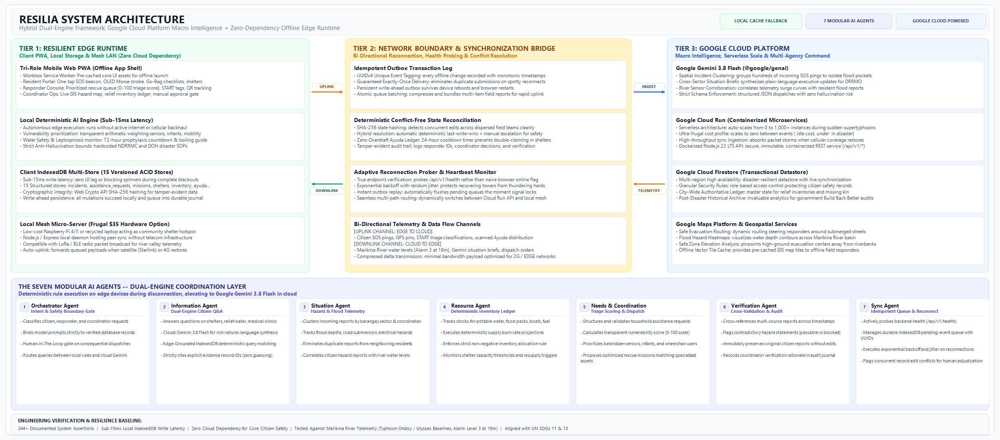

# Resilia — Technical Architecture

**Tagline:** *Maintaining vital community lifelines when networks fail.*  
**Domain:** Community Resilience, Disaster Response, Network-Resilient Systems  
**Context:** Philippine Disaster Risk Reduction (Marikina City River Basin)

---

## 1. High-Level Architectural Topology



```
                  ┌──────────────────────────────────────────────┐
                  │          GOOGLE CLOUD / INTERNET             │
                  │  ┌──────────────────┐  ┌──────────────────┐  │
                  │  │ Google Cloud Run │  │ Google Gemini AI │  │
                  │  │ Express/REST API │  │  (gemini-3.8-    │  │
                  │  │    /api/v1/*     │  │     flash)       │  │
                  │  └────────┬─────────┘  └────────▲─────────┘  │
                  └───────────┼─────────────────────┼────────────┘
                              │ Bidirectional Sync   │ Grounded
                              │ (When Connected)    │ Queries
      ════════════════════════╪═════════════════════╪══════════════════════════
                              │ [Network Boundary]  │
                  ┌───────────▼─────────────────────┴────────────┐
                  │       LOCAL CLIENT BROWSER / PWA             │
                  │                                              │
                  │  ┌────────────────────────────────────────┐  │
                  │  │           React 19 Frontend            │  │
                  │  │  • Resident PWA                        │  │
                  │  │  • Responder Missions                  │  │
                  │  │  • Coordinator Dashboard               │  │
                  │  └───────────────────┬────────────────────┘  │
                  │                      │ Reads & Writes        │
                  │  ┌───────────────────▼────────────────────┐  │
                  │  │       Local-First Data Layer           │  │
                  │  │  • IndexedDB Versioned Database        │  │
                  │  │  • Durable Pending-Event Queue (UUID)  │  │
                  │  │  • Deterministic Rules & Arithmetic    │  │
                  │  │  • Offline Knowledge & Cartography     │  │
                  │  └────────────────────────────────────────┘  │
                  └──────────────────────────────────────────────┘
```

---

## 2. The Seven AI Agents

Resilia implements seven modular agent capabilities coordinated by an orchestrator:

1. **Orchestrator Agent**:
   - Parses user intent.
   - Restricts generative prompts to verified database ground truth records.
   - Enforces human approval requirements on consequential actions.
2. **Information Agent**:
   - Answers natural language questions regarding shelters, relief water, medical clinics, and emergency hotlines.
   - Dual-engine: Calls server-side Gemini 3.8 Flash when online; falls back to deterministic IndexedDB query matching when offline.
   - Cites explicit evidence IDs (`sh_malanday_elem`, `kn_marikina_river_levels`).
3. **Situation Agent**:
   - Clusters incident reports by barangay sector and coordinates.
   - Identifies flood depths, road submersion, and electrical hazards.
4. **Resource Agent**:
   - Tracks inventory ledgers for potable water, food packs, boats, and fuel.
   - Performs deterministic supply depletion arithmetic (burn rates).
   - Prevents negative stock allocations.
5. **Needs & Coordination Agent**:
   - Structures household assistance requests.
   - Calculates transparent vulnerability priority scores (0–100) based on elderly count, infant presence, wheelchair users, and flood severity.
   - Generates mission proposals matching needs with appropriate assets (e.g. wheelchair ramp-equipped shelters, rescue boats).
6. **Verification Agent**:
   - Compares reports across timestamps, source credibility, and flood observations.
   - Flags conflicting road reports (e.g., passable vs impassable).
   - Preserves original reports immutably while recording coordinator verification rationale.
7. **Sync Agent**:
   - Probes real backend health (`/api/v1/health`) rather than browser online flags.
   - Manages durable pending-event queue.
   - Executes idempotent synchronization using UUIDs.
   - Captures concurrent update conflicts for human review.

---

## 3. Physical Community LAN / Edge Deployment Mode

For physical barangay deployments where internet cellular towers are submerged:
- Resilia PWAs can connect to a local low-power mini-PC or Raspberry Pi running a local Resilia node over Wi-Fi mesh or LAN.
- Client repository adapters communicate with `http://resilia-node.local:8080/api/v1`.
- When any node regains satellite (Starlink) or cellular uplink, the Sync Agent automatically uploads queued events to central headquarters.
